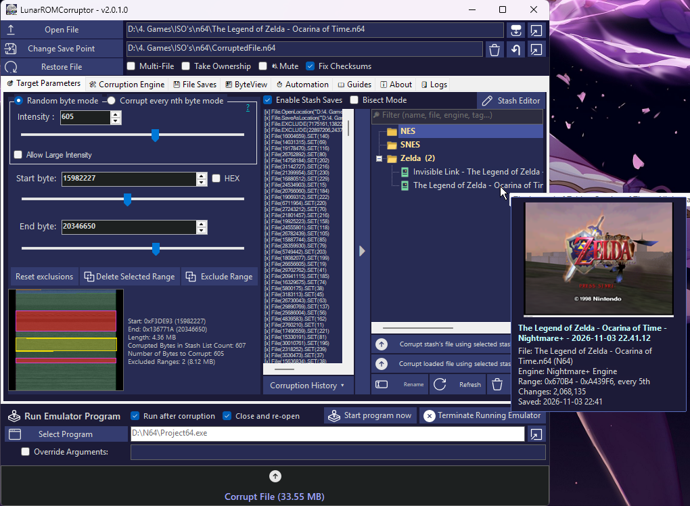
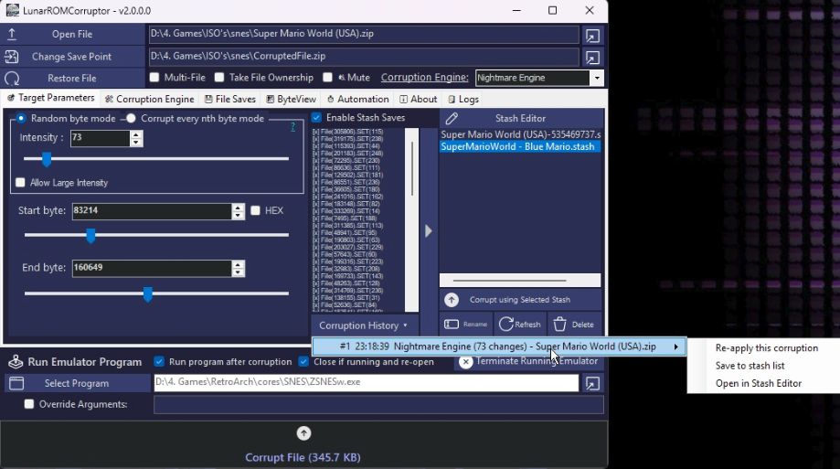
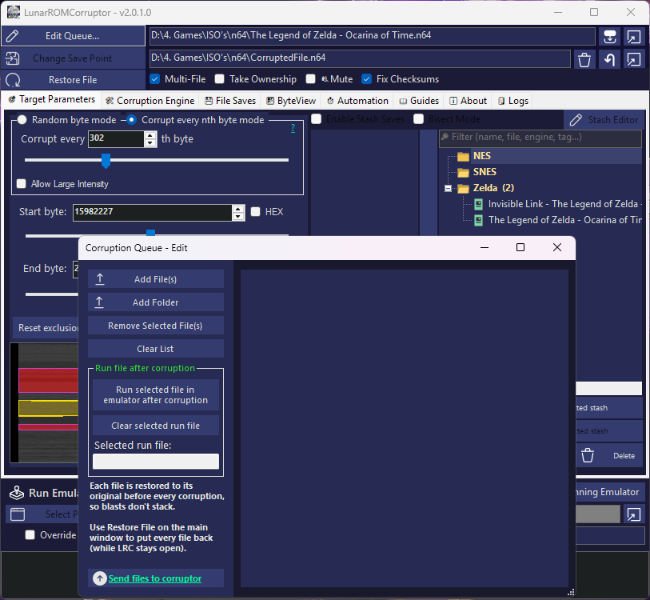
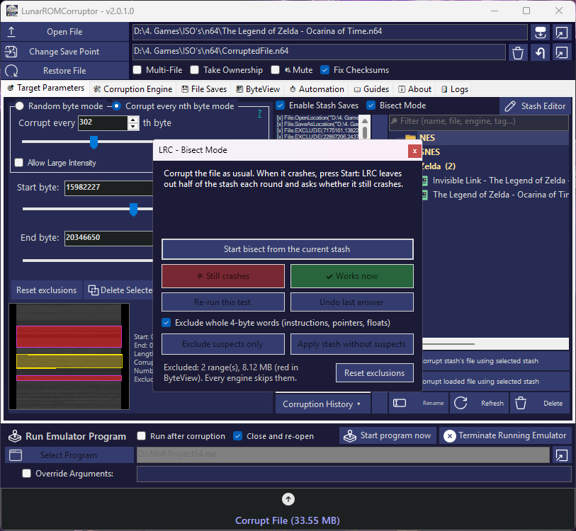
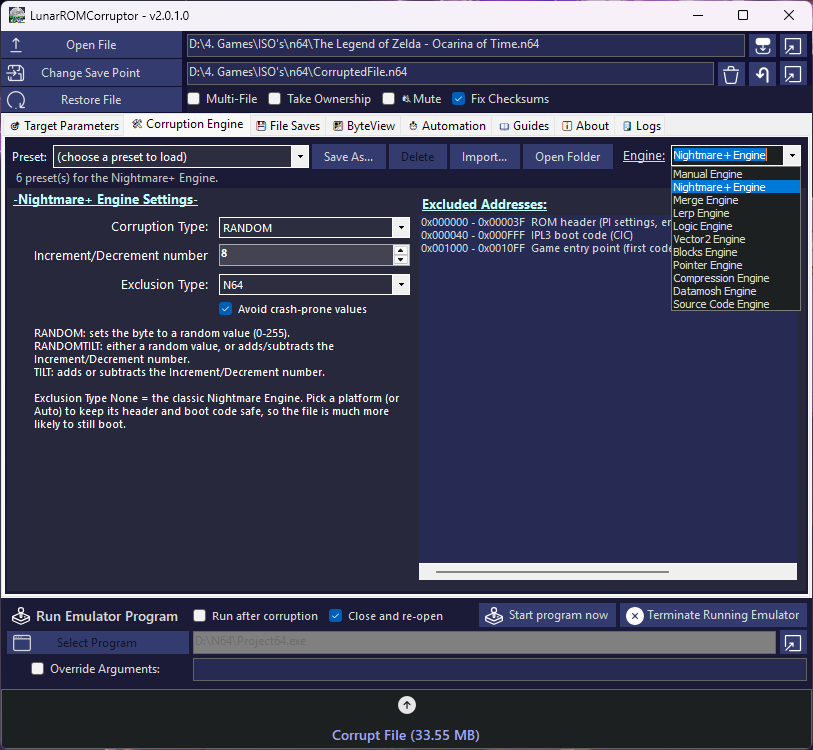

# LunarROMCorruptor

**Versatile, multi-engine file corruption for ROMs and any binary data.**

---

## Overview

LunarROMCorruptor (LRC) corrupts files on purpose, for glitch art, game "corruptions" and finding out how data is laid out. It was made for ROMs, but it works on **any file**: images, audio, video, save files, models, source code.

Instead of one corruption method, LRC has a set of **corruption engines**. Some change random bytes. Others understand what is in the file, such as floats, pointers, compressed blocks, video frames or source code values, so you get unique glitches.

    

---

## Documentation

| Page | What's in it |
| :--- | :--- |
| [**Getting Started**](docs/Getting-Started.md) | Your first corruption, step by step, plus every option on the main window (byte range, intensity, checksums, emulator...). |
| [**Corruption Engines**](docs/Corruption-Engines.md) | Every engine and **every setting explained**, with tips on what to use for what. |
| [**Engine Presets**](docs/Engine-Presets.md) | The built-in presets, saving your own and sharing them (`UserCorruptionEnginePresets`). |
| [**Stashes, Saves & Bisect**](docs/Stash-and-Saves.md) | The stash library (groups, screenshots, notes, ratings, sharing), replaying a stash on its own file, the Stash Editor, Corruption History, Bisect Mode and File Saves. |
| [**ByteView**](docs/ByteView.md) | Seeing the file as an image, Diff / Entropy / Regions modes, dragging to pick the byte range. |
| [**Automation & Multi-File**](docs/Automation-and-Multi-File.md) | Automation tasks, corrupting many files at once, running an emulator after each corruption. |

---

## Key Features

| Feature | Description |
| :--- | :--- |
| **11 Corruption Engines** | Nightmare+, Merge, Logic, Lerp, Manual, Vector2, Blocks, Pointer, Compression, Datamosh and Source Code. [Read about each one](docs/Corruption-Engines.md). |
| **Engine Presets** | Built-in presets for every engine (e.g. *Vector2: N64 models*, *Pointer: N64 texture swap*), plus your own presets you can save and share as `.lrcpreset` files. [More](docs/Engine-Presets.md) |
| **Large File Support** | Files aren't loaded into memory and only the changed bytes are written, so 50 GB+ files work. |
| **Background Corruption** | Corruption runs in the background with a progress bar. Click the corrupt button again to cancel (the output is put back to the original). |
| **Precision Control** | Pick an exact byte range, then use *Every Nth Byte* for predictable results or *Random byte mode* (intensity) for chaos. |
| **Stash Library** | A stash stores only the changed bytes, so it takes almost no space and replays the exact same corruption. Every stash also keeps its file, engine settings, range, a screenshot of the emulator, notes, tags and a rating. Organise them into groups (e.g. *SNES Mario*) by dragging, hover for a preview, double-click to load the file and replay it. Share one as a single `.lrcstash` file. |
| **Stash Editor** | Edit single corrupted bytes, and **Mutate** a corruption you like into variations. Append, sort and remove duplicates too. |
| **Bisect Mode** | Corruption crashed the game? Bisect finds the bytes that cause the crash in a few rounds and excludes them. |
| **Checksum Fixing** | N64, Game Boy, GBA, SNES, Genesis and raw CD sector (EDC/ECC) checksums are fixed after corrupting, so the file still boots. |
| **ByteView** | See the file as an image. Diff, Entropy and Regions modes show what changed and where code, graphics and compressed data are. Drag on it to pick the byte range. |
| **Corruption History** | The last 3 corruptions are automatically kept, so you can re-apply or save one you liked. |
| **Automation** | Randomize intensity, byte range and engine on a timer and corrupt automatically. |
| **Multi-File** | Drop a folder or several files to corrupt them all at once. Every file is restored before each run, and Restore puts them all back. |
| **Run Emulator After Corruption** | Starts your emulator (or any program) with the corrupted file after every corruption. |
| **Built-in Guides** | The *Guides* tab shows these guides inside LRC, always the latest version from GitHub (with an offline copy). |
| **Take Ownership** | Forces access to a protected file. (With great power comes great responsibility... and tested backups.) |

    
    
    

---

## Corruption Engines at a Glance

| Engine | Works on | Best for... |
| :--- | :--- | :--- |
| [**Nightmare+**](docs/Corruption-Engines.md#nightmare-engine) | Bytes | Classic random/tilt corruption. Pick an *Exclusion Type* (or *Auto*) to keep headers and boot code safe. *None* = the original Nightmare Engine. |
| [**Merge**](docs/Corruption-Engines.md#merge-engine) | Bytes | Mixing in the bytes of another file (copy, add or difference). |
| [**Logic**](docs/Corruption-Engines.md#logic-engine) | Bits | `AND`, `OR`, `XOR`, `NOT`, `NAND`, `NOR`, `SWAP` and `SHIFT` on bytes. |
| [**Lerp**](docs/Corruption-Engines.md#lerp-engine) | Bytes | Blending bytes with their neighbours for smooth smears. |
| [**Manual**](docs/Corruption-Engines.md#manual-engine) | Bytes | Exact operations you choose: add, set, replace, divide, repeat... |
| [**Vector2**](docs/Corruption-Engines.md#vector2-engine) | 32-bit floats | Positions, sizes, speeds and model vertices: wobbly, stretched or exploded 3D models. |
| [**Blocks**](docs/Corruption-Engines.md#blocks-engine) | Blocks of data | Pixel sorting, shuffling, smearing and echo for images and audio. |
| [**Pointer**](docs/Corruption-Engines.md#pointer-engine) | Pointers | Swapping which texture, model, sound or text the game loads. Supports N64, GBA, DS, PS1, GameCube/Wii, NES, SNES, Game Boy, Genesis, Saturn, Dreamcast, PS2, PSP and 32-bit Windows EXE/DLL files. |
| [**Compression**](docs/Corruption-Engines.md#compression-engine) | Compressed blocks | Corrupting Yaz0/Yay0/MIO0/LZ10/LZ11 data *inside* the compression, so it glitches instead of crashing. |
| [**Datamosh**](docs/Corruption-Engines.md#datamosh-engine) | AVI video frames | Real datamoshing: keyframe removal (melt) and frame repeats (bloom). |
| [**Source Code**](docs/Corruption-Engines.md#source-code-engine) | Text / code values | `true` becomes `false`, `3.14` becomes `4`, strings get shuffled. Comments are skipped. |

> **Where did the Exclusion Engine go?** It was the Nightmare Engine with exclusion types, so the two are now one engine: **Nightmare+**. Old stashes still work, and settings that mention "Nightmare Engine" or "Exclusion Engine" load into Nightmare+.

    

---

## Quick Start

1. **Open File** (or drag a file onto LRC). The save location is set to `CorruptedFile.<ext>` next to it, so the original isn't touched.
2. Pick an engine on the **Corruption Engine** tab, or choose a preset.
3. On **Target Parameters**, choose the byte range and how much to corrupt (start small: *Random byte mode* with an intensity of 10 to 100).
4. Click **Corrupt File**. Turn on *Run program after corruption* to start your emulator automatically.
5. Like it? Save the stash with the **▶** button next to the stash list. Select it later and click **Corrupt stash's file using selected stash** to get exactly the same corruption.

The full walkthrough is in [Getting Started](docs/Getting-Started.md).

---

## Safety & Disclaimer

> [!CAUTION]
> **CORRUPTION WARNING**
>
> * **Epilepsy Warning:** Corruption can result in rapid, flashing imagery. Use with caution.
> * **System Stability:** Corrupting critical system files (like `system32`) can cause irreversible OS damage. Always use a Virtual Machine for testing.
> * **Anti-Cheat Risk:** Using this tool on online games or protected software **will likely result in permanent account bans**.
> * **No Warranty:** This software is provided **"AS IS"**. The developer is not responsible for any data loss, hardware instability (BSOD), or loss of access to digital accounts.

#### Restore
* If the save location is a different file, the original is never modified and **Restore File** copies the original back.
* If the save location is the original file, the original bytes are kept in a temporary undo journal, so Restore works while LRC is open.

---

## Technical Requirements

* **Runtime:** `.NET 10.0` (Windows Desktop)
* **Development Environment:** `Microsoft Visual Studio 2026` (recommended)
* **Platform:** Windows

## Contributing

Contributions welcome!

1. Fork the Project
2. Create your Feature Branch (`git checkout -b feature/Feature`)
3. Commit your Changes (`git commit -m 'Add some Feature'`)
4. Push to the Branch (`git push origin feature/Feature`)
5. Open a Pull Request

Got a preset that works well for a game or file type? Share the `.lrcpreset` file in an issue or a pull request.

## License

Distributed under the **MIT License**. See `LICENSE` for more information.

Built for Corruption

