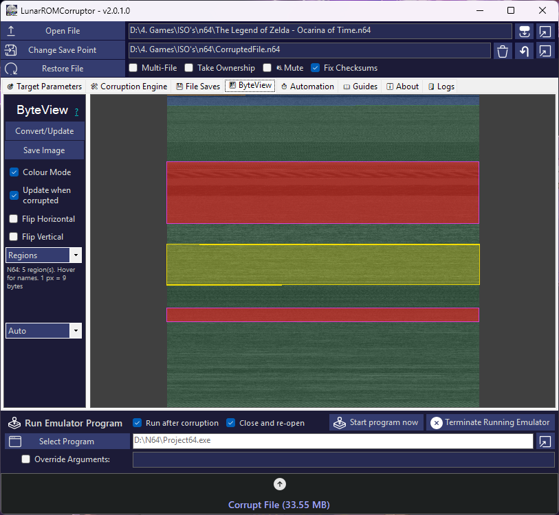

# ByteView

[← Back to the README](../README.md) · [Getting Started](Getting-Started.md) · [Corruption Engines](Corruption-Engines.md) · [Engine Presets](Engine-Presets.md) · [Stashes, Saves & Bisect](Stash-and-Saves.md) · [Automation & Multi-File](Automation-and-Multi-File.md)

ByteView draws a file as an image, one pixel per byte (or per few bytes for big files). Patterns that are invisible in a hex editor become obvious: graphics look like pictures, text and tables look like stripes, compressed data looks like noise and padding is flat.

    

| Control | What it does |
| :--- | :--- |
| **Convert/Update** | Draws the image of the loaded / corrupted file. |
| **Mode** | `Normal`: the bytes as pixels. `Diff`: a grey image with every changed byte in **red** (compares the corrupted file with the original, or uses the stash for in-place corruption). `Entropy`: how random each part of the file is. Padding is dark, text/tables blue/green, code yellow, compressed data red. `Regions`: the named parts of the file for its type (picked automatically or with the list under the mode). Orange = header/boot (what the Nightmare+ exclusion types protect), blue = code, green = data, pink = graphics, purple = compressed blocks. Hover to see a region's name. |
| **Colour Mode** | Colour (RGB) or grayscale pixels. |
| **Flip Vertical / Flip Horizontal** | Flips the image. |
| **Update when corrupted** | Redraws the image after every corruption. |
| **Save Image** | Saves the image as a picture. |

**Targeting:** drag on the image to set the **Start/End byte** to exactly that area (the range is drawn as a yellow box, also on the small preview on the main tab). Right-click resets to the whole file. Hover to see the offset under the mouse.

**Zoom:** scroll wheel to zoom (1-64×) around the cursor, drag with the middle mouse button to move, double-click to reset.

Excluded ranges (Bisect Mode / `EXCLUDE` stash lines) are always drawn in red.
