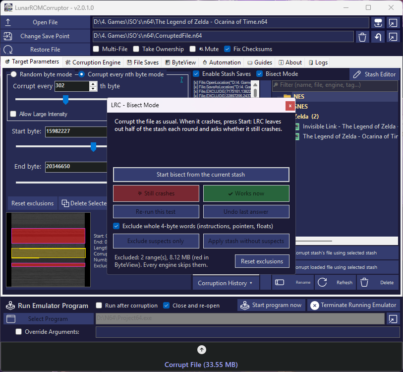

# Stashes, Saves & Bisect

[← Back to the README](../README.md) · [Getting Started](Getting-Started.md) · [Corruption Engines](Corruption-Engines.md) · [Engine Presets](Engine-Presets.md) · [ByteView](ByteView.md) · [Automation & Multi-File](Automation-and-Multi-File.md)

LRC has two ways to keep a corruption:

| | **Stash** | **File Save** |
| :--- | :--- | :--- |
| Stores | Only the changed bytes, plus the file it was made for, how it was made and screenshots | A full copy of the corrupted file |
| Size | Tiny | As big as the file |
| Editable | Yes, in the Stash Editor (change, remove, mutate) | No |
| Folder | `CorruptionStashList` | `Saves` |

---

## Stashes

With **Enable Stash Saves** on, every corruption's changes are listed in the box next to the stash list. Click **▶** (between the two lists) to keep it in the **stash list**.

### What a saved stash remembers

Every stash is its own folder in `CorruptionStashList`:

| File | What's in it |
| :--- | :--- |
| `stash.stash` | The changes (see [the format](#stash-file-format)). |
| `info.json` | Its name, notes, tags and rating, the file it was made for (path, size, CRC32 checksum, type), the save location, the engine **and all its settings**, the byte range and intensity, the emulator it was made with (and its override arguments, if ticked), how many changes it has, and which stash it was based on (Stash Editor variations). |
| `thumbnail.png` | The preview shown when you hover over it. |
| `screenshots\` | Screenshots of the corruption. |

When you save a stash while your emulator is running (started by LRC with *Run program after corruption*), LRC takes a **screenshot of the emulator window** and uses it as the thumbnail. Turn this off on the **⚙️ Settings** tab (*Screenshot the emulator when saving a stash*). Without a screenshot, the ByteView image is used as the thumbnail.

Loading or replaying a stash (*Replay on original file*, *Load*, or **Load engine + range** in its details window) also switches *Run Emulator Program* to the emulator the stash was saved with, and sets its override arguments. If that emulator isn't there anymore, the current one is kept. Turn this off on the **⚙️ Settings** tab (*Switch to the emulator a stash was saved with...*). *Apply to current file* doesn't change the emulator.

Stashes from older versions (single `.stash` files) are moved into their own folder automatically, with their info read from the stash headers. You can still drop plain `.stash` files into the folder.

### The stash list

The stash list is a tree: **groups** (folders, e.g. *SNES Mario*, *N64 > Mario 64*) and **stashes**.

| Action | How |
| :--- | :--- |
| **Replay a stash on its own file** | **Replay on original file**, or right-click > **Corrupt > Replay on original file**. LRC loads the file the stash was made for, sets the save location it used and applies the stash, so you get exactly the same corruption. |
| **Apply a stash to the loaded file** | **Apply to current file** (or right-click > **Corrupt > Apply to current file**). Use it to try a stash on another version of a game, or on a file that has moved. |
| **Preview** | The panel under the list shows the selected stash's thumbnail, file, engine, range, changes, rating and notes (drag its edge to resize it, right-click > *Show preview panel* hides it). Hovering a stash shows the same. Each row shows when the stash was saved and its engine on the right. Stashes whose file isn't there anymore are grey. Groups show how many stashes they hold. |
| **Groups** | Right-click > *New group...* (inside the selected group). Drag stashes and groups onto a group to move them (or onto empty space for the top level), or use *Move to group*. |
| **Rename / Delete** | F2 / Del, right-click > *Organize*, or the buttons under the list. Deleting a group deletes the stashes in it. |
| **Filter** | Type in the box above the list (Ctrl+F): matches names, file names, engines, file types, tags, notes and groups. **Loaded file only** shows just the stashes made for the file that is loaded (same path, or a file with the same name and size). |
| **Details, notes and screenshots...** | Double-click a stash or press Enter. Opens the stash's details window (see below). |
| **Load > Settings only** | Loads the engine settings, byte range and corruption mode/intensity the stash was made with, so you can roll new corruptions like it. |
| **Add screenshot** | From the running emulator, the clipboard, an image file or the current ByteView image. |
| **Rating** | 1-5 stars, shown next to the name. |
| **Export to share / Import** | Exports the whole stash folder (stash, info, screenshots) as one `.lrcstash` file. Others import it with *Import...* or by dropping it on the stash list or on LRC. They need their own copy of the file it was made for. |
| **Show in Explorer** | Opens the stash's folder. |
| **Sort** | The box above the list: name, newest, oldest, rating or file. **Group by file** lists every stash under the file it was made for (with its type), wherever it is in the groups. |

**Safety checks when replaying a stash on its own file:**
* If the file isn't there anymore, LRC asks where it is now and updates the stash.
* If the file has changed since the stash was made (different size or CRC32, e.g. another version or region of the game), LRC warns you first, because the corruption would look different.
* If a different file is loaded, LRC asks before replacing it.

### Stash details window

Double-click a stash (or press Enter, or right-click > **Details, notes and screenshots...**) to open it. It shows the screenshots (big preview + strip), lets you add screenshots (**Emulator**, **Paste**, **Add file...**), pick which one is the thumbnail and remove them, and edit the **name, rating, tags and notes**. The info box shows everything LRC recorded. **Locate file...** points the stash to its file if it moved, **Load engine + range** and **Corrupt stash's file** do the same as *Load > Settings only* and *Replay on original file* in the list.

### Corruption History

**Corruption History** keeps the last 20 corruptions of this session: re-apply one, save it to the stash list (with its engine settings), or open it in the Stash Editor. Handy when you forgot to save a good one. The **⏳ History** tab shows them all in a table.

### Stash file format

A stash is a text file with one entry per line:

| Line | Meaning |
| :--- | :--- |
| `[x] File.OpenLocation("C:\Games\game.z64")` | **Header:** the file that was loaded. Used by *Replay on original file*. |
| `[x] File.SaveAsLocation("C:\Games\CorruptedFile.z64")` | **Header:** where the corrupted file was saved. |
| `[x] File.EXCLUDE(start,end)` | Bytes start to end (inclusive) are excluded. They're never changed, and applying the stash adds them to the session's excluded ranges. |
| `[x] File(offset).SET(value)` | Set the byte at *offset* to *value* (decimal). Most engines write this. |
| `[x] File(offset).VARLINE("name",line).SET("text")` | Source Code Engine: replace the value at that position with *text*. |
| `[x] File(offset).FRAME(frame).SET(DROP\|REPLACE\|REPEAT,n)` | Datamosh Engine: drop, replace or repeat a video frame. |

The headers are written at the top of every new stash. Stashes made before headers existed still work with *Apply to current file*. *Replay on original file* tells you when a stash has no headers, or when its file has moved. If the save location's folder no longer exists, the default save location next to the file is used.

---

## Stash Editor

| Tool | What it does |
| :--- | :--- |
| **Open File** | Opens a stash file. |
| **Create new stash item** (*Location*, *Value*, **Add**) | Adds a `SET` entry by hand. |
| **Remove / Remove Selected / Remove 50%** | Moves entries to *Removed items* (Remove 50% moves the first half, handy for finding which half of a corruption does something). **Restore** puts them back, **Permanently Remove ALL** clears the removed list. |
| **Mutate stash** | Makes a **variation** of the corruption: changes *Mutate %* of the byte entries. *Random value* gives them a new random value, *Nudge value* adds/subtracts up to *Amount*, *Move address* moves them up to *Amount* bytes. **Mutate list** changes the list, **Mutate, save new & corrupt** saves it as a new stash and applies it right away. |
| **Append stash file...** | Adds the entries of another stash (combine two corruptions). |
| **Sort by address** | Sorts the byte entries (headers and other lines stay at the top). The result doesn't change. |
| **Remove duplicates** | Removes entries that a later entry for the same address overwrites. The result doesn't change. |
| **Save as new stash / Save stash and Corrupt** | Saves your changes (and applies them). A new stash keeps the original's info and group, is called *(edited)* or *(mutation)*, and remembers which stash it was based on. |

---

## Bisect Mode

    

Found a corruption that is *almost* perfect, but crashes? **Bisect Mode** (checkbox above the stash list) finds the changes that cause the crash.

1. Corrupt as usual until you get a crash.
2. Tick **Bisect Mode** and press **Start bisect from the current stash**.
3. LRC applies the stash **without** half of the suspect changes and runs the emulator. Answer **Still crashes** or **Works now**. Each answer halves the suspects (**Undo last answer** and **Re-run this test** if you're unsure).
4. After a few rounds (about 13 for 5,000 changes) only the culprits are left. Then pick one:
   * **Apply stash without suspects**: excludes the suspects and applies the whole original stash except those changes, so you get your corruption back without the crash. This ends the bisect. If it still crashes, there's more than one culprit, so press Start again.
   * **Exclude suspects only**: just adds the suspects to the excluded ranges. Nothing is re-applied and the bisect keeps going. Use it to exclude suspects early and carry on.

   *Exclude whole 4-byte words* widens them to the full instruction/pointer/float.

ByteView shows the half that was left out in cyan. Excluded ranges are shown in red, no engine will change them until you **Reset exclusions**, and they're saved in stashes as `EXCLUDE` lines. You can also exclude any byte range yourself with **Exclude Range** on the main tab (see [Getting Started](Getting-Started.md#target-parameters)). They're cleared when a different file is loaded.

---

## File Saves

File saves sit next to the stash list on the **Target Parameters** tab: switch between **📦 Stashes** and **💾 File Saves** above the list (LRC remembers which one you used last).

| Control | What it does |
| :--- | :--- |
| **Enable Auto File Saves** | Copies every corrupted file into `Saves` automatically. |
| **Save** | Copies the current corrupted file into `Saves`. |
| **Copy to save location** | Puts the selected save back at the save location (e.g. to run it again). Double-clicking a save does the same and starts the emulator if *Run after corruption* is on. Each save shows its date and size. |
| **Reload list / Rename / Delete / Open Folder** | Manage the saves. |
